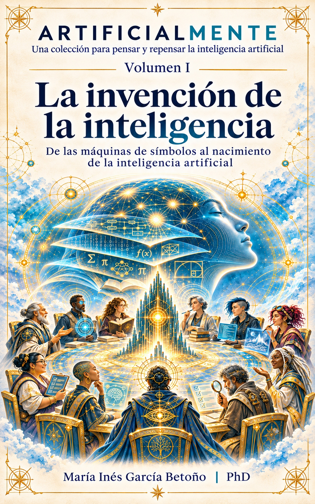

# ARTIFICIALMENTE

### Una colección para pensar y repensar la inteligencia artificial

**María Inés García Betoño | PhD**

  

---

## ¿Qué es ARTIFICIALMENTE?

**ARTIFICIALMENTE** es una colección de libros dedicada a comprender la inteligencia artificial desde sus fundamentos históricos, científicos, matemáticos, epistemológicos y tecnológicos hasta los problemas de criterio, responsabilidad, gobernanza y liderazgo que plantea su incorporación a nuestra vida cotidiana.

La colección nació originalmente como un proyecto personal de aprendizaje.

No empecé estos libros pensando en publicarlos. Quería construirme una biblioteca: volver a los fundamentos de la inteligencia artificial, refrescar conceptos, comprender mejor las tecnologías actuales y, sobre todo, generar preguntas.

Con el tiempo descubrí que ese recorrido podía ser útil para otras personas. Por eso decidí compartirlo.

> **¿Qué significa pensar y repensar la inteligencia artificial mientras estamos aprendiendo a vivir con ella?**

---

## Volumen I · Disponible

### La invención de la inteligencia
**De las máquinas de símbolos al nacimiento de la inteligencia artificial**

El primer volumen recorre lógica, computación, neuronas artificiales, Dartmouth, teoremas, perceptrones, ELIZA, DENDRAL, aprendizaje automático, redes neuronales, atención y modelos generativos.

### Descargas

- [EPUB para lectura](https://github.com/migarciab/ARTIFICIALMENTE/releases/download/vol1-v1.0/ARTIFICIALMENTE_Vol_I_La_invencion_de_la_inteligencia.epub)
- [EPUB para escucha / TTS](https://github.com/migarciab/ARTIFICIALMENTE/releases/download/vol1-v1.0/ARTIFICIALMENTE_Vol_I_La_invencion_de_la_inteligencia_ESCUCHA.epub)
- [PDF](https://github.com/migarciab/ARTIFICIALMENTE/releases/download/vol1-v1.0/ARTIFICIALMENTE_Vol_I_La_invencion_de_la_inteligencia.pdf)

---

## La colección

| Vol. | Título | Estado |
|---|---|---|
| I | **La invención de la inteligencia** | ✅ Disponible |
| II | El problema de saber | 🟡 En edición |
| III | La arquitectura del pensamiento | 🟡 En desarrollo |
| IV | El universo de la incertidumbre | ⚪ Planificado |
| V | La matemática de aprender | ⚪ Planificado |
| VI | El lenguaje que transformó las máquinas | ⚪ Planificado |
| VII | Conversar con sistemas que no piensan como nosotros | ⚪ Planificado |
| VIII | Cuando las máquinas comenzaron a actuar | ⚪ Planificado |
| IX | El mundo escrito en código | ⚪ Planificado |
| X | Diseñar lo que todavía no existe | ⚪ Planificado |
| XI | El precio de delegar | ⚪ Planificado |
| XII | La inteligencia de las organizaciones | ⚪ Planificado |
| XIII | Después de la inteligencia artificial | ⚪ Planificado |
| XIV | El criterio | ⚪ Planificado |
| XV | Chief AI Officer | ⚪ Planificado |

La arquitectura recorre cinco movimientos:

**comprender → aprender → construir → asumir consecuencias → decidir.**

---

## Sobre la autora

Soy **María Inés García Betoño**, doctora en Ciencias Naturales.

Mi formación académica no comenzó en informática. Durante buena parte de mi carrera trabajé en ciencias naturales, investigación, biodiversidad y posteriormente en sistemas de información geográfica, datos, accesibilidad, neurodivergencias y transformación digital.

En 2026 comencé a desarrollar mi propia arquitectura de trabajo con inteligencia artificial, configurada con instrucciones, criterios y materiales propios.

ARTIFICIALMENTE nació de una idea muy simple:

**construirme una biblioteca para aprender.**

Cuando terminé el primer volumen pensé:

> **Esto me sirvió muchísimo. Tal vez también pueda servirle a alguien más.**

---

## Inteligencia artificial y proceso editorial

La inteligencia artificial tuvo una participación sustantiva en la producción de ARTIFICIALMENTE.

Diferentes agentes y módulos configurados por la autora colaboraron en investigación, organización, contraste de información, edición, revisión, estructuración, diseño y producción editorial.

La participación de inteligencia artificial no se oculta. Forma parte del propio objeto de la colección.

Las decisiones conceptuales, la selección de contenidos, la arquitectura de la colección, los criterios editoriales y la responsabilidad sobre cada versión publicada corresponden a **María Inés García Betoño**.

---

## Disclaimer

ARTIFICIALMENTE es un proyecto de aprendizaje, actualización y exploración crítica sobre inteligencia artificial.

No pretende sustituir una revisión sistemática de literatura, un tratado académico especializado, una fuente primaria ni asesoramiento científico, médico, jurídico, financiero o profesional.

Se procura verificar hechos, referencias y afirmaciones relevantes utilizando fuentes científicas, históricas y técnicas. Sin embargo, pueden persistir errores, imprecisiones o interpretaciones sujetas a revisión.

La invitación central es:

**leer, preguntar, contrastar, dudar, verificar y volver a pensar.**

---

## Accesibilidad

Los libros se diseñan intentando favorecer EPUB reflowable, navegación estructurada, jerarquía semántica, tecnologías de asistencia y versiones optimizadas para TTS.

---

## Derechos y licencias

**© 2026 María Inés García Betoño. Todos los derechos reservados.**

Los libros completos no están licenciados globalmente bajo Creative Commons. Los materiales abiertos que se publiquen en el futuro indicarán expresamente su licencia.

---

## Cómo citar

**García Betoño, María Inés. 2026. _La invención de la inteligencia: De las máquinas de símbolos al nacimiento de la inteligencia artificial_. ARTIFICIALMENTE, vol. I.**

---

# Más criterio
